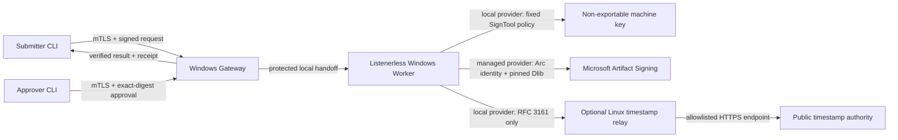

# Windows Code Signing Appliance

A project-agnostic, profile-driven appliance for signing a narrowly defined set of Windows
artifacts with Authenticode. It separates the network-facing API from the process that can use the
signing key, requires independently signed submission and approval records, and validates every
artifact before and after signing.

This repository is infrastructure for building a dedicated signing appliance. It is not a hosted
service and does not ship a production consumer profile, production configuration, certificate, or
ready-made release archive. An operator must review and compile an application-specific profile,
provide identity and network policy, build a sealed release, and complete native acceptance on the
target Windows environment.

## What it supports

| Capability | Status |
| --- | --- |
| Dedicated Windows Gateway and listenerless signing Worker | Implemented |
| Local Machine, non-exportable CNG Authenticode key used through pinned SignTool | Implemented |
| Private HTTPS API with mutual TLS | Implemented |
| Detached CMS submitter signature and exact-digest approval signature | Implemented |
| Distinct submitter and approver identities in production | Required |
| Statically compiled, versioned consumer profiles | Implemented |
| Cross-platform command-line client | Implemented for Windows and Linux |
| Narrow Linux RFC 3161 timestamp relay | Implemented; required by the current hardened Local Machine deployment |
| Generated-key Windows acceptance tests | Implemented |
| Microsoft Artifact Signing Worker provider | Implemented, including closed V3 release packaging and Azure Arc-aware installation; native acceptance is required for each target release |
| Runtime profile uploads or arbitrary signing options | Intentionally unsupported |

The services target .NET 10. Gateway, Worker, installer, and Authenticode operations are Windows
components. The CLI also targets Linux. The timestamp relay is a separate Linux service. The
project is independent of hypervisor, cloud, and hardware vendor: the Windows appliance may be a
physical machine or a dedicated VM on any platform that provides the required isolation and
recovery controls.

## Security boundary



The Gateway is the only remotely reachable appliance component and has no permission to use the
Authenticode key. The Worker has no network listener. It independently re-hashes and revalidates
the request after approval, signs only files declared by compiled profile code, and publishes a
closed result archive plus signed receipt. A failed or ambiguous signing directory is quarantined
and never resumed.

The timestamp relay is useful when the Windows signer must not have general Internet access. It is
not a timestamp authority or general proxy: it accepts only bounded timestamp requests from exact
client addresses and connects only to one reviewed upstream hostname through an exact IP allowlist.
Deploy it on a separate Linux workload, not on the Windows signer or a virtualization management
host. A deployment may use another reviewed egress design, but timestamp and revocation uncertainty
must still fail closed.

Read the [architecture](docs/architecture.md) and [threat model](docs/threat-model.md) before
planning a deployment.

## What it is not

The appliance deliberately does not provide:

- arbitrary-file signing or client-selected SignTool arguments;
- remote command execution, build, publishing, deployment, or artifact hosting;
- certificate enrollment, renewal, export, backup, or general key management;
- runtime plugins, profile uploads, assembly discovery, or policy selected by a client;
- an Internet-facing public API or a general network proxy; or
- a safe way to repurpose an existing signing machine without a fresh acceptance process.

Those boundaries are part of the security design, not missing convenience features.

## Recommended deployment

The normal deployment consists of:

1. one new, dedicated Windows machine or VM for Gateway and Worker;
2. either one non-exportable Authenticode key in the Windows Local Machine certificate store or a
   narrowly scoped Microsoft Artifact Signing managed identity/profile;
3. separate Gateway TLS and Worker receipt-signing identities;
4. separate submitter and approver client identities;
5. one application-specific profile package built in its owning repository;
6. an isolated private network with exact ingress and egress policy; and
7. one small Linux workload for controlled access to a public RFC 3161 authority when using the
   Local Machine deployment.

Use an enterprise CA, managed enrollment process, or reviewed signing provider for production
identities. Self-signed and generated identities are for disposable testing only. Never copy a PFX
or private-key state into this repository, a release archive, or an operations evidence directory.

## From source to a signing request

There is no web setup wizard. A release is assembled offline from reviewed source, configuration
templates, a deployment manifest, and at least one compiled profile package.

### 1. Build and test the source

Install the SDK selected by [`global.json`](global.json), PowerShell 7, and Git. On Windows,
install an x64 Windows SDK SignTool for native acceptance.

```bash
git clone <repository-url>
cd windows-code-signing-appliance
dotnet restore ArtifactSigning.sln --locked-mode \
  -p:NuGetAudit=true -p:NuGetAuditMode=all -p:NuGetAuditLevel=low
dotnet format ArtifactSigning.sln --verify-no-changes --no-restore
dotnet build ArtifactSigning.sln --configuration Release --no-restore
dotnet test ArtifactSigning.sln --configuration Release --no-build --no-restore
dotnet list ArtifactSigning.sln package --vulnerable --include-transitive
```

The cross-platform suite is necessary but not sufficient for deployment. Run the generated-key
Windows matrix and installer/restart/reboot tests on a disposable Windows machine before a release
can reach a real key. See [development and testing](docs/development.md).

### 2. Implement a consumer profile

A profile is compiled .NET code implementing `ISigningProfile`. It declares exact project and
profile identities, accepted artifact names and sizes, signer and timestamp policy aliases, input
validation, deterministic finalization, and signed-output validation.

Keep production profile source in a separate repository owned by the consuming project. Build one
managed assembly and a canonical `profile-package.txt`, then deliver those reviewed bytes to the
appliance release process. The synthetic projects under `tests/ArtifactSigning.TestProfile*` are an
executable reference, not a production profile.

Start with [profile authoring](docs/profile-authoring.md), then follow
[profile package operations](docs/profile-package-operations.md).

### 3. Prepare identities and network policy

Provision the dedicated Windows machine, certificate stores, service identities, private address,
Windows Time peers, SignTool installation, Linux timestamp relay, and out-of-band recovery channel.
Record only public thumbprints and digests in reviewed configuration; never export the
Authenticode key.

Follow [getting started](docs/getting-started.md), [identity operations](docs/identity-operations.md),
and [Windows installation and hardening](docs/windows-installation-hardening.md). For the managed
provider, also follow [Microsoft Artifact Signing](docs/microsoft-artifact-signing.md). Managed
releases use deployment V3, package the complete pinned Microsoft client-tools directory, and
reconcile only the Worker service identity into Azure Arc's local identity-access group.

### 4. Create the reviewed release inputs

The release builder requires:

- a complete Gateway configuration template;
- a complete Worker configuration template;
- canonical `deployment.txt` for the target machine;
- one or more canonical profile package manifests;
- a new output directory; and
- for Microsoft Artifact Signing, the complete reviewed client-tools directory containing the
  pinned Dlib.

Configuration is strict, case-sensitive JSON using PascalCase properties. Unknown, duplicate,
missing, or cross-mode values are rejected. Profiles choose preinstalled signer and timestamp
policy aliases; clients never provide a certificate, timestamp URL, executable path, output path,
or SignTool option.

See the [configuration reference](docs/configuration-reference.md) for every configuration family
and the fixed installer substitutions.

### 5. Compose and build a sealed release

Run the builder from a clean worktree whose exact `HEAD` matches `SourceCommit` in `deployment.txt`:

```powershell
.\installer\Build-ArtifactSigningRelease.ps1 `
  -GatewayConfigurationTemplate C:\reviewed\gateway.template.json `
  -WorkerConfigurationTemplate C:\reviewed\worker.template.json `
  -Deployment C:\reviewed\deployment.txt `
  -ProfilePackageManifest C:\reviewed\profile-package\profile-package.txt `
  -OutputRoot C:\release\artifact-signing-unique-output
```

For a managed-provider release, also pass
`-MicrosoftArtifactSigningClientToolsDirectory C:\reviewed\Microsoft.ArtifactSigning.Client\bin\x64`.
The builder rejects that argument for a Local Machine release.

The builder statically composes the exact profile assemblies, publishes self-contained Windows
services and CLI, creates the package-set lock, and emits a closed release inventory. Authorize the
printed inventory digest through an independent channel. Do not authorize a path or display name.

### 6. Install on the dedicated Windows machine

Use a local or independently secured out-of-band console. The installer applies deny-by-default
firewall policy and can intentionally terminate an ordinary remote session.

```powershell
.\installer\stage-artifact-signing-release.ps1 `
  -Source C:\reviewed\artifact-signing-reviewed-release `
  -ExpectedReleaseHash <independently-supplied-lowercase-sha256>

C:\ProgramData\ArtifactSigningInstaller\staging\installer\install-artifact-signing-service.ps1 `
  -ExpectedReleaseHash <same-independent-sha256> `
  -Mode Install
```

Run the installed verifier after installation, after separate Worker and Gateway restarts, and
after reboot. Do not loosen an ACL, firewall rule, revocation setting, or time policy to make a
failed verification pass.

### 7. Configure the clients

Install the CLI built with the identical profile set. Give submitter and approver separate
owner-only configurations and identities. The CLI configuration pins the Gateway certificate and
SPKI and defines public trust for request and receipt signatures. Production requires online
revocation.

```bash
artifact-signctl profiles list --config /owner-only/submitter.json

artifact-signctl submit --config /owner-only/submitter.json \
  --project example-project \
  --profile ExampleBundleV1 \
  --bundle /owner-only/unsigned-bundle \
  --source-repository example/repository \
  --source-commit 0123456789abcdef0123456789abcdef01234567 \
  --release-version 1.2.3

artifact-signctl review --config /owner-only/approver.json \
  --request 00000000-0000-0000-0000-000000000000 \
  --expected-digest <independently-verified-lowercase-sha256> \
  --format json

artifact-signctl approve --config /owner-only/approver.json \
  --request 00000000-0000-0000-0000-000000000000 \
  --reason-file /owner-only/review-reason.txt \
  --expected-digest <independently-verified-lowercase-sha256>
```

After approval, use `wait`, `download`, and `verify`. Download revalidates the receipt, archive,
hashes, package binding, and profile-specific output before atomically creating a new file. Full
command and evidence requirements are in [client operations](docs/client-operations.md).

## Repository layout

| Path | Purpose |
| --- | --- |
| `src/ArtifactSigning.Protocol` | Canonical request, approval, receipt, archive, signature, and state contracts |
| `src/ArtifactSigning.Profiles` | Public profile ABI and static registry contracts |
| `src/ArtifactSigning.Gateway` | Private mTLS API, authorization, durable gateway state, and Worker handoff |
| `src/ArtifactSigning.Worker` | Listenerless signing coordinator, key use, result publication, and audit state |
| `src/ArtifactSigning.Windows` | Authenticode verification and fixed hash-pinned SignTool adapters |
| `src/ArtifactSigning.Cli` | Cross-platform submitter, approver, download, and verification client |
| `src/ArtifactSigning.TimestampRelay` | Narrow Linux RFC 3161 relay |
| `installer/` | Offline release builder and hardened Windows install/update/rollback scripts |
| `eng/ProfileComposition/` | Offline static profile package composer |
| `deploy/linux/timestamp-relay/` | systemd and firewall examples using placeholder addresses |
| `tests/ArtifactSigning.TestProfile*` | Synthetic example profile and its tests |
| `tools/ArtifactSigning.DisposableLab` | Generated-identity disposable Windows acceptance support |

## Documentation

- [Getting started](docs/getting-started.md)
- [Architecture and trust boundaries](docs/architecture.md)
- [Configuration reference](docs/configuration-reference.md)
- [API contract](docs/api-contract.md)
- [Client operations](docs/client-operations.md)
- [Approval client integration](docs/approval-client-integration.md)
- [Profile authoring](docs/profile-authoring.md)
- [Profile package operations](docs/profile-package-operations.md)
- [Identity operations](docs/identity-operations.md)
- [Windows installation and hardening](docs/windows-installation-hardening.md)
- [Timestamp relay operations](docs/timestamp-relay-operations.md)
- [Operations runbook](docs/operations-runbook.md)
- [Recovery runbook](docs/recovery-runbook.md)
- [Threat model](docs/threat-model.md)
- [Development and testing](docs/development.md)
- [Implementation status](docs/implementation-status.md)
- [Microsoft Artifact Signing status](docs/microsoft-artifact-signing.md)

## Maturity and support

Components are independently versioned and currently pre-1.0. Treat every configuration, profile,
dependency, and installer change as a reviewed release change. This repository does not make a
source checkout production-ready and does not authorize mutation of a live key or signing machine.
See [SECURITY.md](SECURITY.md) for reporting and deployment expectations.

## Contributing and license

Contributions are welcome under [CONTRIBUTING.md](CONTRIBUTING.md). The project is licensed under
the [Apache License 2.0](LICENSE).
