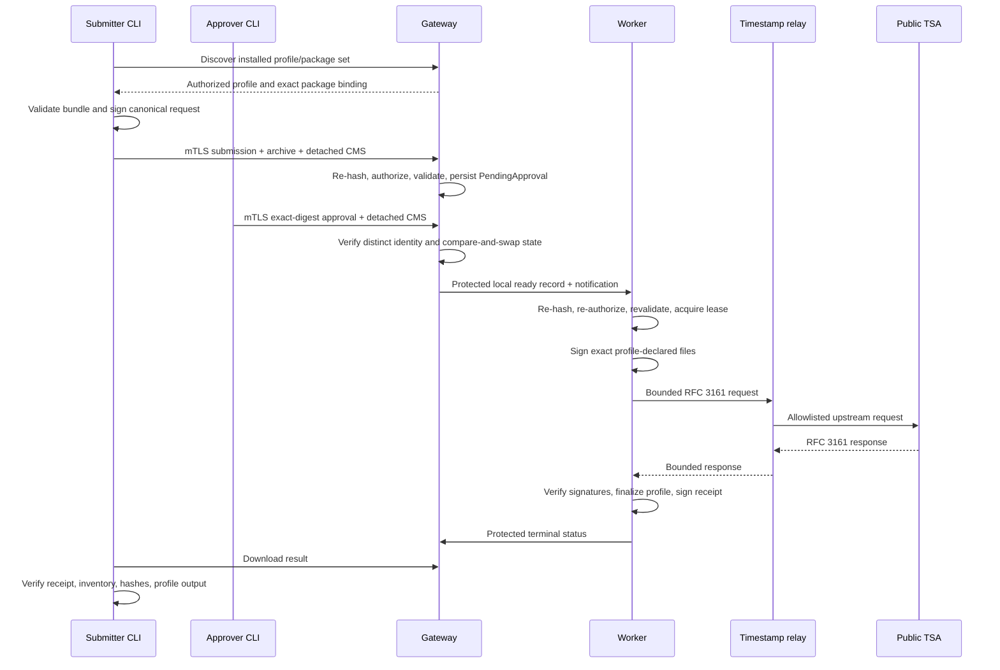

# Architecture and trust boundaries

## Design goal

The appliance permits a reviewed, project-specific set of Windows artifacts to receive an
Authenticode signature without exposing the signing key to a network-facing process. It combines
three independent controls:

1. a compiled profile defines exactly what may be signed;
2. a submitter signs the complete request and an independent approver signs its exact digest; and
3. a listenerless Worker repeats validation before it can use a non-exportable key.

The design assumes that a machine administrator can install reviewed releases and inspect protected
state. It does not try to defend a live software key from a fully compromised Windows administrator.
Use a managed or hardware-backed provider when that threat must be addressed.

## Components

### Gateway

`ArtifactSigning.Gateway` is a Windows service listening on one private address with required mutual
TLS. It authenticates the client certificate, verifies detached CMS signatures, enforces the
compiled project/profile authorization policy, validates the request archive with the compiled
profile, persists bounded state, and hands an approved record to the Worker.

The Gateway can read completed output only after the Worker projects an exact read-only ACL. Its
service identity has no permission to use the Authenticode or receipt-signing private keys.

### Worker

`ArtifactSigning.Worker` is a Windows service with no network listener. It receives only a local,
protected notification after Gateway approval. The Worker opens the approved archive from protected
state, re-hashes and revalidates it, obtains a single signing lease, invokes one installed
hash-pinned SignTool executable directly with a fixed grammar, validates the resulting signatures,
and creates the final archive and signed receipt.

The Worker identity alone can use the Authenticode and receipt keys. It does not accept executable
paths, certificate selectors, timestamp URLs, signer aliases, profile implementations, output
paths, or command options from a request.

### CLI

`artifact-signctl` is the cross-platform client used by submitters and approvers. It includes the
same statically composed profile set as the appliance release. It validates input before submission,
verifies discovery/package binding, exposes a bounded machine-readable review for protected
operator portals, creates detached CMS signatures, and verifies downloaded results and receipts.
It never contacts the Worker or signing key.

### Profile packages

A profile package is separately built operator-controlled .NET code. Offline composition verifies
the package manifest and assembly digest, creates static registrations, and compiles the exact
package set into Gateway, Worker, and CLI. There is no runtime assembly discovery or upload path.

The profile sees a bounded artifact reader rather than a filesystem path. It declares exact artifact
roles, safe leaf names, file kinds, size limits, signer/timestamp aliases, and validation/finalization
logic. A client can select only a project/profile identity already authorized by the installed
release.

### Timestamp relay

`ArtifactSigning.TimestampRelay` is a Linux service that narrows the Windows Worker's timestamp
egress. It accepts only RFC 3161 request media from exact private client addresses, permits one
reviewed upstream URL and exact destination addresses, and returns only a valid timestamp response
media type. It has no access to request archives or signing keys.

The current hardened Local Machine certificate deployment uses the relay as a fixed dependency.
This prevents the Windows signer from resolving arbitrary names or opening general Internet
connections merely because SignTool needs a public timestamp. The relay may run on any suitably
isolated Linux machine, VM, or container with enforced network policy.

## Request lifecycle

### Discovery

The client first asks the Gateway which project/profile identities are visible to its mTLS
identity. The response binds each profile to the exact package, descriptor, assembly, and package
set digests. A CLI compiled with different profile bytes refuses to submit.

### Submission

The CLI constructs a canonical request record and a closed uncompressed tar archive. The detached
submitter signature covers the request. Gateway checks the mTLS certificate and CMS signer against
the same authorized identity, validates expiry and nonce rules, rejects archive ambiguity, computes
the public request digest, and stores the request as `PendingApproval`.

### Approval

An approver reviews the request through an independent process and signs the exact request digest
plus bounded reason. Production authorization requires submitter and approver SPKIs to differ.
Approval uses a compare-and-swap transition, preventing a stale approval from changing an already
terminal or changed request.

### Signing and publication

The Worker repeats identity, signature, archive, digest, profile, policy, and filesystem checks. It
signs only the descriptor's exact artifacts and requires timestamp and revocation verification.
After deterministic profile finalization, it builds a closed response archive and detached receipt,
then projects a protected read-only result for the Gateway. Partial or uncertain work is quarantined.

## State and filesystem ownership

Durable metadata is bounded SQLite state; artifact bytes remain protected files. Installed binaries
and configuration live beneath protected `%ProgramFiles%`; mutable state lives beneath protected
`%ProgramData%`. Every security-sensitive path is revalidated as a direct regular path with exact
ownership, ACL, link, and reparse-point rules before use.

Gateway and Worker use explicit state transitions with compare-and-swap semantics. Startup
reconciliation checks database state, audit continuity, package binding, filesystem placement, and
ACLs before work can continue. A request interrupted during key use is quarantined rather than
resumed.

## Identity separation

Production uses distinct identities for:

- Gateway TLS termination;
- Worker receipt and audit signing;
- Worker Authenticode signing, either a local non-exportable key or one profile-scoped managed identity;
- each submitter;
- each approver; and
- optional read-only auditors.

Only public trust is installed for remote clients. Private client keys remain with their owners.
For the Local Machine provider, the Windows installer verifies that Gateway cannot use Worker keys
and that the Authenticode key is a non-exportable Local Machine CNG key. For Microsoft Artifact
Signing, it gives only the Worker service identity local access to the Arc machine identity and
never installs an Authenticode private key. See [identity operations](identity-operations.md).

## Deployment independence

The code assumes network and host properties, not a particular virtualization product. A supported
environment must provide:

- a new dedicated Windows machine or VM;
- a private static address and exact ingress allowlist;
- reliable Windows Time peers;
- an independently secured local or out-of-band console;
- a clean pre-key recovery point for disposable acceptance;
- protected identity enrollment; and
- a separate Linux relay workload for the current hardened Local Machine track.

Equivalent controls can be implemented on physical hardware, a private hypervisor, or a cloud
provider. Provider-specific automation and live environment inventories belong in a separate
private operations repository.

## Failure model

The appliance fails closed on signature, digest, archive, profile, signer, timestamp, revocation,
audit, state, configuration, ACL, dependency, or restart uncertainty. API and CLI errors expose
bounded problem codes and safe messages; raw SignTool output, exception dumps, local paths,
certificate contents, and operating-system diagnostics are not returned remotely.

Recovery restores a complete reviewed generation. It never edits durable state to force progress,
resumes a partially signed directory, broadens permissions, or exports a key. See the
[operations](operations-runbook.md) and [recovery](recovery-runbook.md) runbooks.
